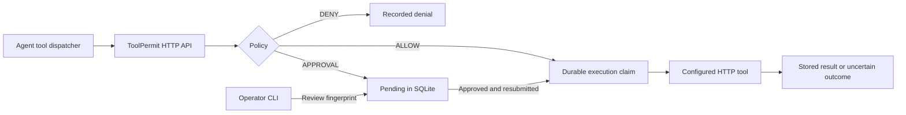

# ToolPermit

[](https://github.com/Almeida96/toolpermit/actions/workflows/ci.yml)
[](https://kotlinlang.org/)
[](LICENSE)

A local approval broker for agent tool calls, written in Kotlin for Java 21.

Let an agent search notes automatically, require an operator's approval before creating one, and deny deletion. ToolPermit evaluates a policy before forwarding a request to a configured HTTP tool. It stores approvals, results, and state transitions in SQLite so a repeated request does not silently repeat a side effect.

## Try the complete flow

Download [toolpermit-0.1.0.zip](https://github.com/Almeida96/toolpermit/releases/download/v0.1.0/toolpermit-0.1.0.zip) from the [release](https://github.com/Almeida96/toolpermit/releases/tag/v0.1.0), extract it, and run with Java 21 or later:

```sh
bin/toolpermit demo --out results/demo
```

On Windows, use `bin\toolpermit.bat`. Choose a new output directory on each run.

The demo starts real local HTTP services and an isolated database. Its operator step is scripted; it does not call a model or ask for a model key.

| Step | Result |
| --- | --- |
| Search notes | Allowed and forwarded |
| Create a note | Held in `PENDING`; no file written |
| Approve the reviewed request | Changes to `APPROVED` |
| Resubmit the same request | Writes `notes/write-1.txt` once |
| Resubmit it again | Returns the stored result; no second write |
| Delete a note or write outside the sandbox | Denied |

Inspect `results/demo/summary.json`, `audit.json`, and the created note. The demo fails if these assertions do not hold.

## How it works



The agent can submit requests and read their status. Approval is a local CLI operation against the database; there is no HTTP approval route. Give the agent access to the broker, and keep the database, policy, operator commands, and upstream credentials outside its permissions.

## Configure a policy

The included [policy](examples/policy.json) has three tools. This excerpt requires approval and limits the target workspace:

```json
{
  "schemaVersion": 1,
  "approvalTtlSeconds": 600,
  "tools": [
    {
      "name": "notes.create",
      "action": "APPROVAL",
      "endpoint": "http://127.0.0.1:9000/notes/create",
      "constraints": [
        {"type": "one_of", "path": "/workspace", "values": ["sandbox"]}
      ]
    }
  ]
}
```

Unknown tools are denied. Argument constraints must all pass before an approval can be requested. Endpoints come from the policy, never the incoming invocation. See [policy rules](docs/policies.md) for JSON Pointer matching, numeric bounds, expiry, and policy changes.

## Connect an agent

Start your HTTP tool adapter on port 9000 using the [upstream contract](docs/http-api.md#upstream-tool-contract). Set `TOOLPERMIT_TOKEN` to a random secret in the broker and agent environments, then start the broker:

```sh
bin/toolpermit serve --policy examples/policy.json --db results/toolpermit.db --token-env TOOLPERMIT_TOKEN
```

It listens on `127.0.0.1:8787`. The example endpoints are configuration examples; the demo uses its own temporary services. Every API request requires the bearer token. For POSIX shells:

```sh
curl --fail-with-body http://127.0.0.1:8787/v1/invocations \
  -H "Authorization: Bearer $TOOLPERMIT_TOKEN" \
  -H 'Content-Type: application/json' \
  --data-binary @examples/create-note.json
```

On PowerShell, use `$env:TOOLPERMIT_TOKEN` and `curl.exe`, or `Invoke-RestMethod`. A valid submission can still be denied: inspect its `state`, not only the HTTP status.

When the response is `PENDING`, pause the agent's action. From a separate operator terminal:

```sh
bin/toolpermit pending --db results/toolpermit.db
bin/toolpermit inspect --db results/toolpermit.db --id note-001
bin/toolpermit approve --db results/toolpermit.db --id note-001 --fingerprint REVIEWED_SHA256
```

Replace `REVIEWED_SHA256` with the fingerprint from `inspect`, after checking the tool and complete arguments. Use `reject` instead of `approve` to refuse the operation. Approval alone does not execute it: the agent resubmits the original request with the same ID and arguments. Polling `GET /v1/invocations/note-001` never dispatches a tool.

An ID reused with different arguments or a different tool returns `409`. Completed requests return their stored result. Generate an ID once per intended operation and retain it across retries. See the [API contract](docs/http-api.md) for all statuses and integration rules.

## Failure handling

A durable SQLite claim is committed before dispatch. Concurrent submissions sharing an ID cannot both claim execution, including across separate database connections. Approval is bound to the reviewed arguments and policy, and expires at the original deadline.

Network failures, non-2xx responses, invalid responses, and timeouts become `UNKNOWN`. The remote tool may already have acted, so ToolPermit does not replay them. A process crash after claiming leaves `DISPATCHING`; inspect the upstream system before taking further action. This is at most one dispatch attempt per retained request ID, not an exactly-once side-effect guarantee.

## Data and deployment boundaries

The database contains raw arguments and successful tool results. Protect it and its SQLite sidecar files with filesystem permissions. `inspect` intentionally prints arguments for review; `audit` exports only IDs, fingerprints, states, reasons, timestamps, and actor categories. Audit rows are ordinary database records, not signed or tamper-proof evidence.

Version 0.1.0 targets one local trust domain with one bearer credential. It is not an Internet-facing, multi-tenant gateway or an MCP server. An agent that can read the database or run operator commands can bypass the approval boundary. See [architecture and operations](docs/operations.md) for resource limits, recovery, and deployment assumptions.

## Build and test

```sh
git clone https://github.com/Almeida96/toolpermit.git
cd toolpermit
./gradlew test installDist distZip
build/install/toolpermit/bin/toolpermit demo --out results/demo
```

Use `gradlew.bat` on Windows. The wrapper downloads Gradle and dependencies on the first build. Tests cover policy validation, approval expiry, SQLite concurrency and restarts, HTTP authentication, bounded requests/responses, uncertain outcomes, CLI exit codes, and the complete demo. CI runs on Linux and Windows with Java 21.

- [Policy reference](docs/policies.md)
- [HTTP API and tool adapters](docs/http-api.md)
- [Architecture, limits, and recovery](docs/operations.md)
- [Contributing](CONTRIBUTING.md)
- [Changelog](CHANGELOG.md)

The [MCP tool specification](https://github.com/modelcontextprotocol/modelcontextprotocol/blob/main/docs/specification/2026-07-28/server/tools.mdx#user-interaction-model) discusses operator control over tool invocations. ToolPermit implements a separate HTTP approval workflow that an agent or MCP tool handler can call; it does not implement MCP transport or replace an upstream tool's authorization checks.

## License

[MIT](LICENSE).
